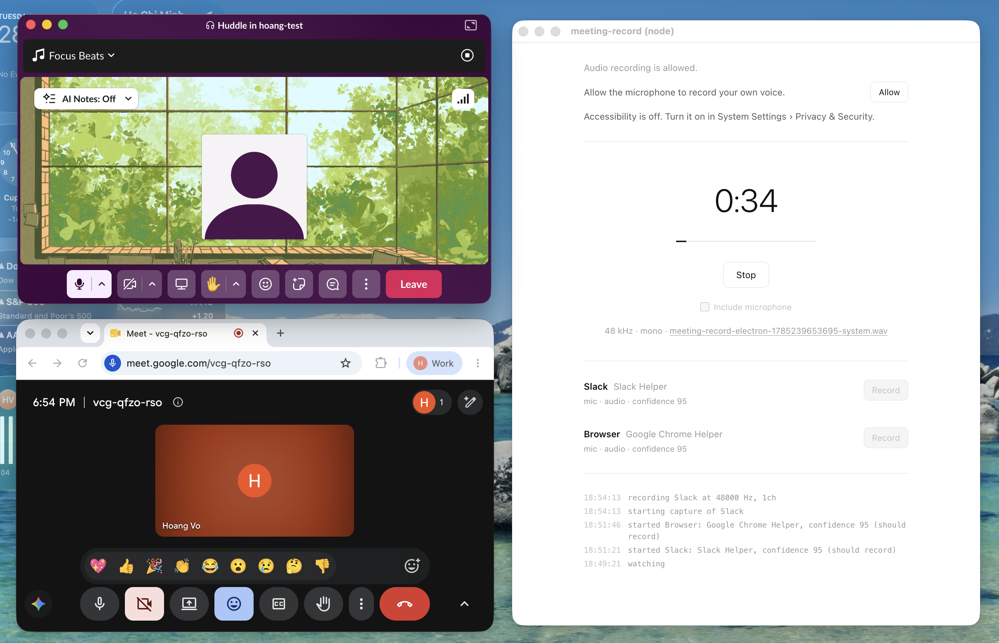

# meeting-record

System-audio and microphone capture with meeting detection for macOS and Windows.

## Packages

- [Node.js / TypeScript](./node/README.md)
- [Rust](./rust/README.md)

## Examples



- [Tauri](./apps/tauri/README.md) (Rust binding)
- [Electron](./apps/electron/README.md) (Node.js binding)

Need an AI Note-taker? Check out [fireflies.ai](https://fireflies.ai/?utm_source=github&utm_medium=referral&utm_campaign=hoangvvo_meeting-record).

## Platform support

| Platform | Minimum version | Architectures |
| -------- | --------------- | ------------- |
| macOS    | 14.2            | arm64, x86-64 |
| Windows  | 10 build 19041  | arm64, x86-64 |

macOS app requirements:

- Signed, running as a GUI app.
- `NSAudioCaptureUsageDescription` in `Info.plist`.
- `NSMicrophoneUsageDescription` only for the microphone track.

```xml
<key>NSAudioCaptureUsageDescription</key>
<string>Records meeting audio so it can be transcribed.</string>
<key>NSMicrophoneUsageDescription</key>
<string>Records your voice so meetings can be transcribed.</string>
```

## Permissions

| Permission        | Needed for                    | macOS prompt           |
| ----------------- | ----------------------------- | ---------------------- |
| **System Audio**  | Any capture                   | One-time modal dialog. |
| **Microphone**    | The microphone track          | One-time modal dialog. |
| **Accessibility** | Meeting titles and URLs (opt) | System Settings.       |

- Requests are asynchronous: request, then poll the status.
- Windows: no prompts. System Audio and Accessibility report `granted`.
- Windows: Microphone reports Settings › Privacy & security › Microphone; `denied` there → capture start fails with a permission error.

## Detection

| ID        | Name                         |
| --------- | ---------------------------- |
| `zoom`    | Zoom                         |
| `teams`   | Microsoft Teams              |
| `meet`    | Google Meet                  |
| `webex`   | Webex                        |
| `slack`   | Slack                        |
| `discord` | Discord                      |
| `browser` | Other browser-based meetings |

- Record when `shouldRecord` / `should_record` is true, including listen-only meetings.
- The watcher reports `started`, `updated` and `ended` on a serial queue.
- `started` needs ~2 s of detection; `ended` ~3 s of absence.
- Windows: a Meet call in a background tab is `meet` with an empty `url`.

## Capture

- **Process target:** recommended; the meeting app and its helpers.
- **System target:** all application audio.
- **Microphone:** opt-in. `default` follows the OS default input on both platforms. `auto` prefers the captured app's mic on Windows, falling back to the communications default; macOS uses its default input.
- A lost device never stops a recording: its track is retried until the device returns. Explicitly requested sources must be available at startup.
- Track availability is `live`, `degraded` (some sources missing), or `interrupted` (none available). Tracks report these transitions; the microphone also reports `devicechange`.
- Every captured app exiting interrupts system audio (`app-exited`); the microphone and session remain alive. A relaunched app is a new process target and requires a new capture session.
- Process capture follows replacement audio helpers within the selected app's lifetime. macOS refreshes helpers about once a second; Windows follows child processes.
- **Mixed output:** optional mono s16le from both bindings. A missing input contributes silence while another input continues. Intervals over one second with no input from any track are omitted, so recovery does not backfill a long silence. Raw packet timestamps retain the original clock.
- Stop preserves captured audio; drain each output to its end to consume the final tail.
- Node raw tracks yield `{ pcm, hostTimeNs, frameCount, sampleRate, channels, droppedSamples }` packets. `mixedAudio` yields byte buffers.
- Source pickers: [`meetings.audioApps()`](./node/README.md#audio-apps) (Node.js), [`meetings::audio_apps()`](./rust/README.md#audio-apps) (Rust).

## Troubleshooting

| Symptom                                        | Fix                                                           |
| ---------------------------------------------- | ------------------------------------------------------------- |
| Capture start times out (macOS)                | Request permissions from a bundled GUI app.                   |
| Capture outputs zeroes                         | The target exited; rescan.                                    |
| Titles/URLs empty (macOS)                      | Grant Accessibility, then relaunch.                           |
| "none of the requested pids are running" (Win) | The target exited; rescan.                                    |
| "no default microphone is available" (Win)     | Enable a recording device, or capture without the microphone. |

## Development

Lint and format:

```sh
npm run lint:fix && npm run fmt
cargo +nightly clippy --all-targets --all-features --workspace && cargo +nightly fmt
```

Unit tests:

```sh
npm test
cargo test -p meeting-record --all-targets
```

macOS E2E:

```sh
MREC_IDENTITY="$(security find-identity -v -p codesigning | awk '/Developer ID Application/ { print $2; exit }')" ./e2e/macos.sh
```

Windows E2E (needs Python and the Visual Studio C++ build tools):

```powershell
./e2e/windows.ps1                                    # system + process, both bindings
./e2e/windows.ps1 -Binding Rust                      # one binding
./e2e/windows.ps1 -MicrophoneDevice "CABLE Input"    # + virtual-cable microphone
./e2e/windows.ps1 -SwitchMicrophone "Stereo Mix"     # + default-microphone switch
./e2e/windows.ps1 -Mode Meeting -MeetingPid 1234     # a live meeting
```
